<p align="center"></p>

<p align="center"><b>Two Commodore 64 SID chips as a synth, on the M-VAVE FM-1.</b></p>

<p align="center"><a href="https://sid-1.putch.co.uk/"><b>Open the web app</b></a> (Chrome or Edge)</p>

SID-1 is open-source firmware for the M-VAVE FM-1 keyboard. It runs an accurate recreation of the C64's sound
chip, the MOS SID, twice over: six voices, three on each chip, with the 6581 or the 8580 to choose from. It turns
them into a synth you play from the FM-1's own keys and knobs, or over USB MIDI.

Its patches work the way a C64 music player's instruments do, updated 50 times a second: an envelope and a waveform,
a wavetable for drums, arpeggios and noise attacks, pulse width and filter sweeps, vibrato and hard restart. It holds
a library of 128 of them in 4 banks of 32, starting with 16 factory patches. A companion web page edits and
organises them, and pulls the instruments and sampled drums out of a C64 tune (`.sid`), then plays the tune on the
FM-1 as MIDI.

<p align="center">
  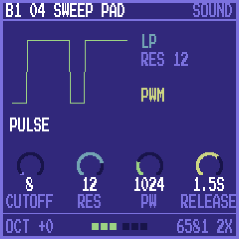
  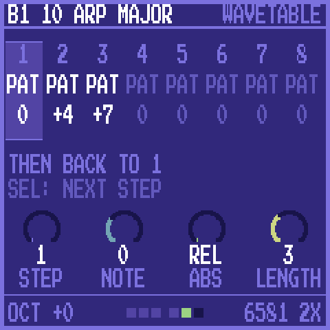
  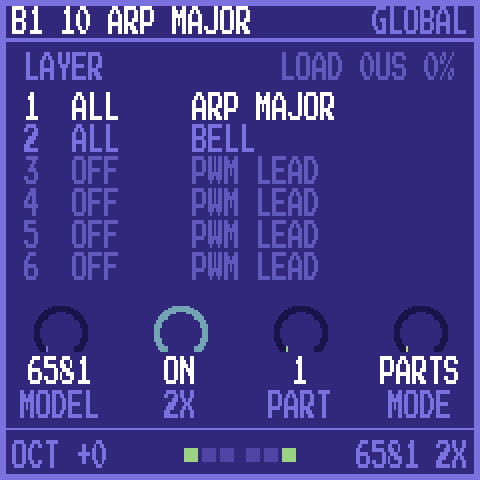
</p>

## Features

- **An accurate chip.** `sid.c` is a C port of Dag Lem's reSID 0.16, integer only, and matches it sample for sample
  in the tests, for both the 6581 and the 8580. Both chips run on the FM-1's own CPU, with optional 2x
  oversampling. reSID 1.0's more accurate filter needs megabytes of tables, more than the FM-1 has, so the port
  is of 0.16.
- **C64 instruments as patches.** ADSR and waveform (with sync, ring modulation and the test bit), an 8-step
  wavetable that can play absolute notes (drums) or relative ones (arpeggios), a pulse width sweep, a filter sweep
  with its mode and resonance, delayed vibrato, transpose and fine tune, and hard restart.
- **The C64's filter, as it was.** Each chip has one filter for its three voices. A filtered patch's note restarts
  its chip's sweep, as on a C64, and the FM-1 gives filtered patches a chip each where it can, so each keeps its
  own filter.
- **A patch library.** 128 slots in 4 banks of 32, kept in flash. PRESETS on the FM-1 steps through them and a
  MIDI program change picks one. The page copies, moves, renames and empties them, and saves banks to JSON files
  and back.
- **Single, Layer, Split or Voices.** Out of the box the FM-1 plays one patch, up to six notes at once. **Layer**
  stacks up to six patches on every note. **Split** gives each MIDI channel its own patch, for a sequencer or DAW.
  **Voices** makes MIDI channels 1 to 6 the six voices, one note each, the way a C64 tune plays them.
- **Edit on the device or the page.** Nine knob pages on the FM-1 for the sound, the envelope, the pulse and filter
  sweeps, vibrato and the wavetable. The page's editor shows every field at once and plays changes as you make them.
  SAVE keeps the patch in its slot.
- **Patches from C64 tunes.** Drop a `.sid` file (PSID or RSID, from the HVSC) on the page: it runs the tune on its
  own 6502 and finds the instruments it plays, ready to send to the library.
- **A tune's sampled drums.** Many C64 tunes play drums by writing samples to the SID's volume register, a trick
  that works because the 6581 leaks a DC offset. The page finds those samples too and sends them to the FM-1's
  sample kit, played on MIDI channel 10 through the volume register in the same way. Heard on the 6581, as on a
  real C64.
- **Songs as MIDI.** The page plays a tune on the FM-1 as MIDI in voices mode, each SID voice on its own channel
  with its instruments, slides as pitch bend and the drums on channel 10, or saves it as a `.mid` file for a DAW.
  Close to the original, not exact.
- **MIDI over USB or the TRS jack.** By default the patch plays on channels 1 to 9 and 11 to 15, with the sample kit
  on 10. Pitch bend is 2 semitones each way, up to 24 with RPN 0.

## The FM-1's screens

| | | |
| :---: | :---: | :---: |
|  | 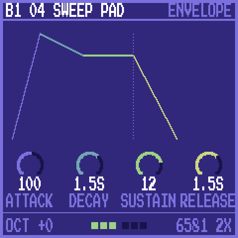 | 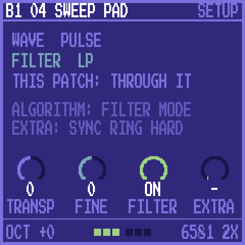 |
| **HOME:** the waveform, the filter, the main knobs | **ENV:** attack, decay, sustain, release, drawn | **EDIT:** transpose, fine tune, filter, sync, ring, hard restart |
| 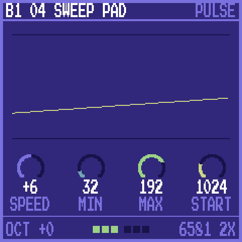 | 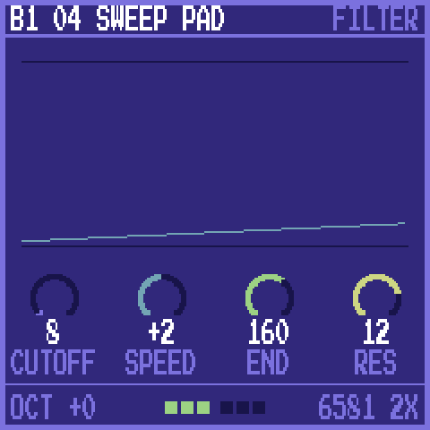 | 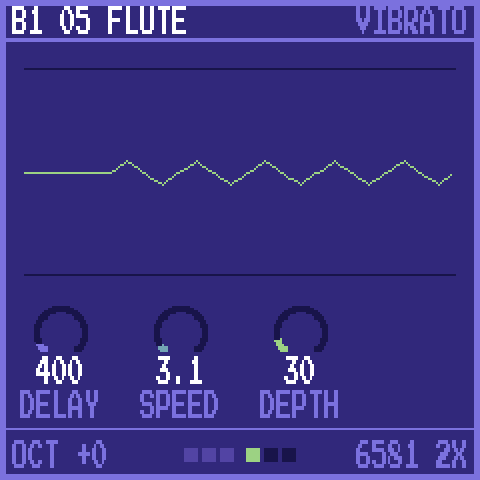 |
| **FX:** the pulse width sweep | **FX again:** the filter sweep | **LFO:** vibrato |
|  | 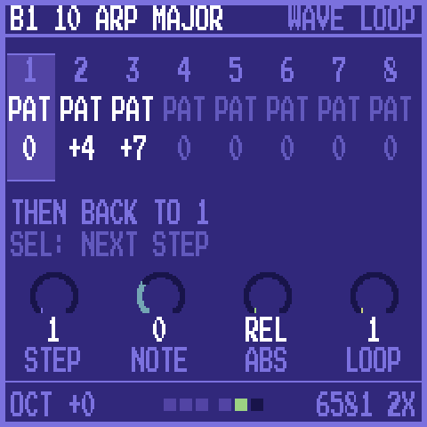 |  |
| **ARP:** the wavetable's steps | **ARP again:** where it loops | **GLO:** chip model, 2x, the part, the mode; the parts |

ALGORITHM changes the waveform, the filter mode or a wavetable step's waveform, depending on the page. OCT- and OCT+
move the keys an octave. The footer shows the six voices: lit while a note plays.

## The web app

<p align="center">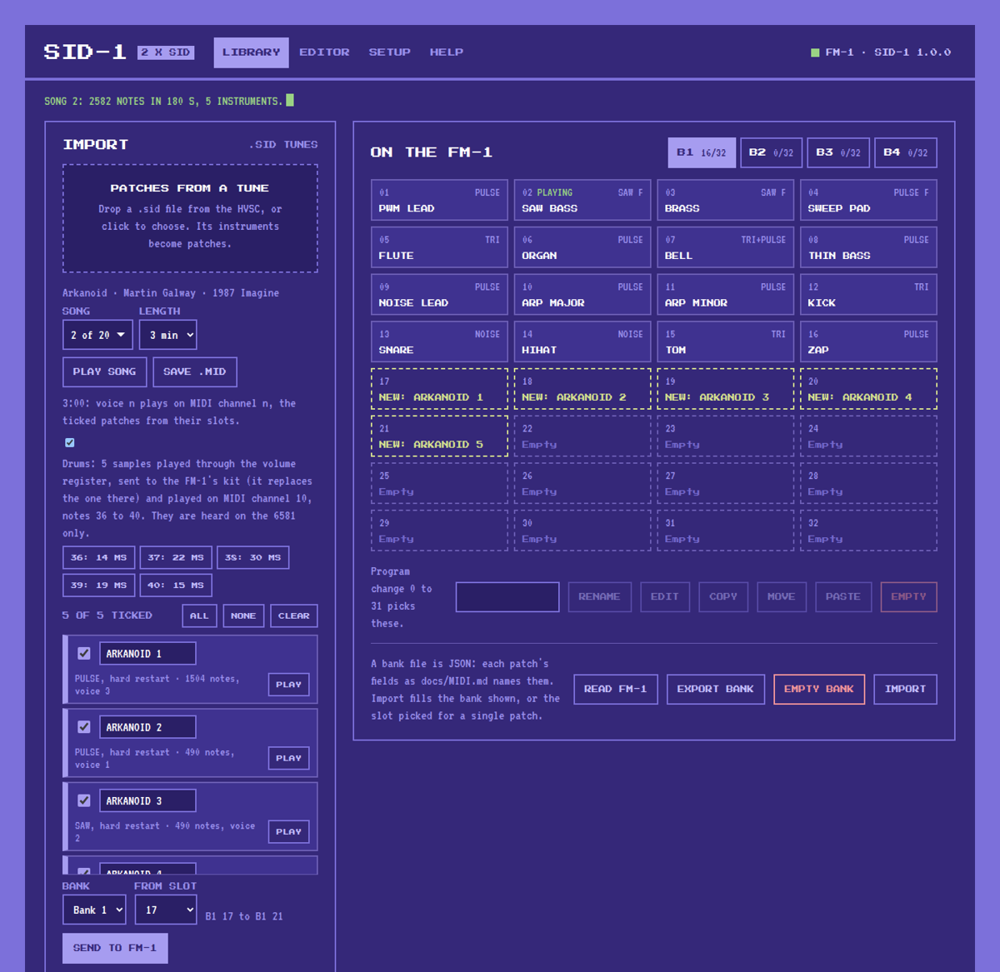</p>
<p align="center"><b>Library:</b> import a <code>.sid</code> tune, tick its patches, pick a bank and slot and send them, with its drums for the kit. Play the song on the FM-1 or save it as a <code>.mid</code>.</p>

<p align="center">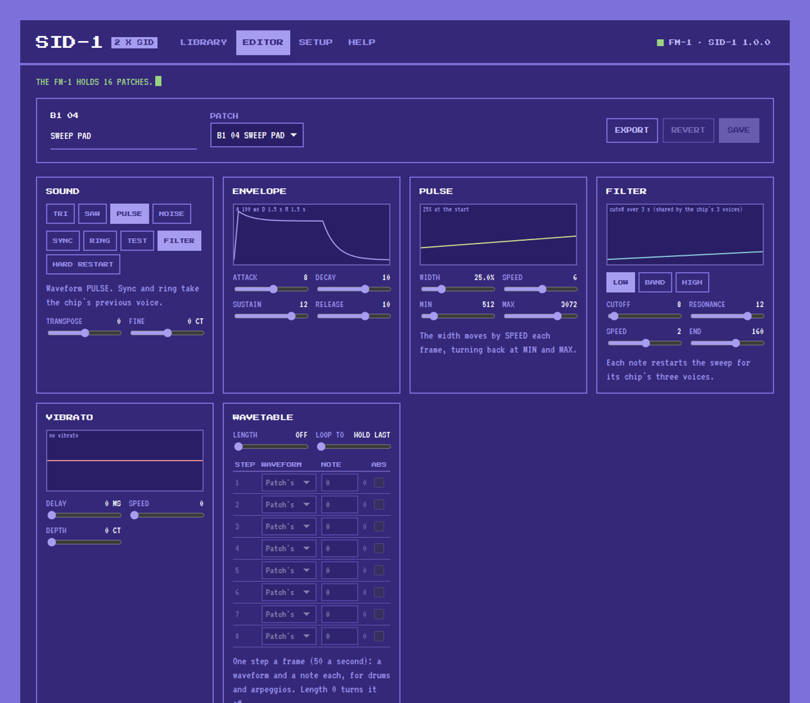</p>
<p align="center"><b>Editor:</b> pick a patch, change it and hear it on the FM-1 as you go, then save it to its slot.</p>

<p align="center">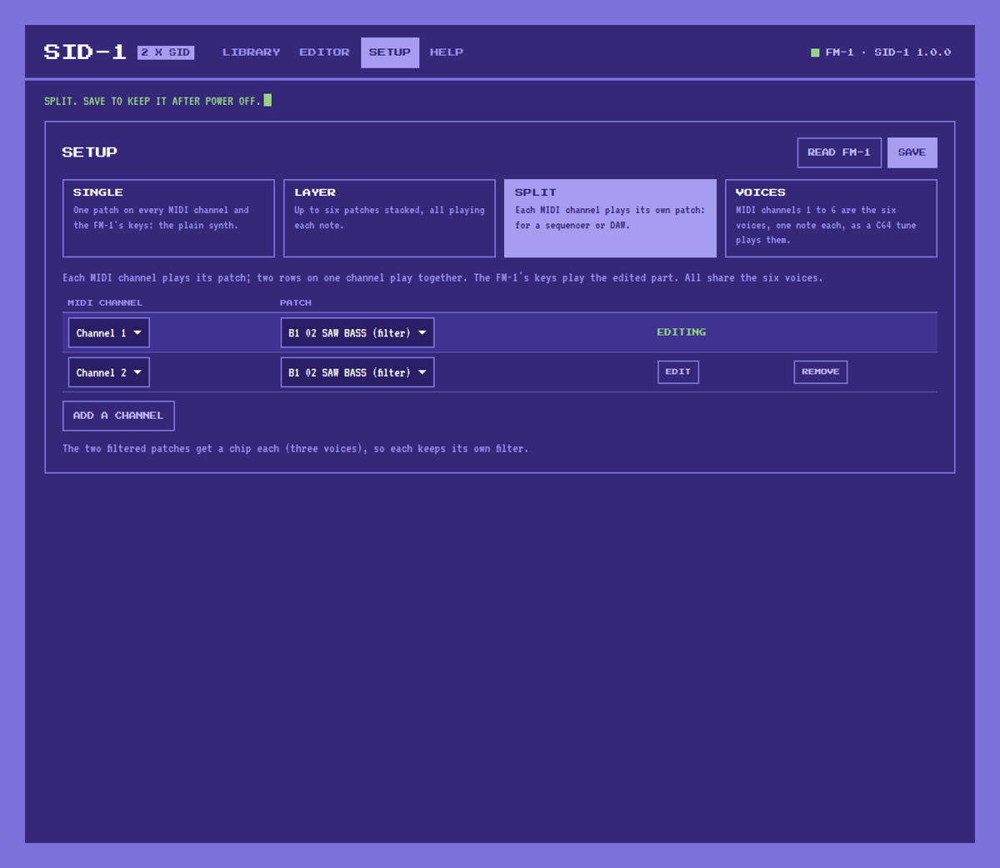</p>
<p align="center"><b>Setup:</b> Single, Layer, Split or Voices, each part's patch and channel, and which part the FM-1's keys play.</p>

## Getting started

1. **Install the firmware** on the FM-1, as in [Installing the firmware](#installing-the-firmware) below.
2. **Open the web app** in Chrome or Edge: **<https://sid-1.putch.co.uk/>**. To run it locally instead
   (Web MIDI needs https or localhost):

   ```sh
   cd web && python3 -m http.server 8000          # then open http://localhost:8000/
   ```

3. **Play.** Turn PRESETS to step through the 16 factory patches in bank 1.
4. **Add patches.** In the Library, drop a `.sid` tune, tick the patches you want, pick a bank and a start slot,
   and press **Send to FM-1**. SID-1 does not include any C64 music; use files you have the right to use, such
   as those of the High Voltage SID Collection.

The web app's **Help** tab explains every button and knob on the FM-1, and what to do when something goes wrong.

**Rescue:** if the FM-1 ever fails to start, hold **OCT-** while switching it on. It starts the USB updater only,
so a working firmware can be installed from there.

## Installing the firmware

You need the FM-1 plugged in over USB and Python 3. The commands below run from the SID-1 project folder:

1. Get the project: **Code > Download ZIP** on GitHub and unzip it, or
   `git clone https://github.com/putchdev/sid-1.git`.
2. Download the `.fwsc` from the [latest release](https://github.com/putchdev/sid-1/releases/latest) into that
   folder, or build one (see [Building and testing](#building-and-testing)). In the commands below, use the name of
   your file.

Close anything else that talks to the FM-1 over MIDI first, including the SID-1 page and any DAW. On Windows only
one program at a time can use it.

**Windows.** Install Python from [python.org](https://www.python.org/downloads/), ticking "Add python.exe to PATH".
Open Command Prompt in the project folder and run:

```bat
py -m pip install mido python-rtmidi
py tools\fm1_install.py sid1-1.0.0.fwsc
```

**macOS.** Install Python from [python.org](https://www.python.org/downloads/) (or `brew install python`). Open
Terminal in the project folder and run:

```sh
python3 -m venv ~/.venv/fm1
~/.venv/fm1/bin/pip install mido python-rtmidi
~/.venv/fm1/bin/python tools/fm1_install.py sid1-1.0.0.fwsc
```

**Linux.** On Debian or Ubuntu:

```sh
sudo apt install python3-mido python3-rtmidi
python3 tools/fm1_install.py sid1-1.0.0.fwsc
```

On other distributions, use the macOS commands (Python's `venv` module may be a separate package).

The installer asks before it writes anything. The FM-1 then restarts into SID-1, shows its version on the screen
and appears to the computer as **SID-1 FM-1**. `tools/fm1_install.py --info` shows what the connected FM-1 runs. If
an install is cut off, run the same command again and it finishes.

SID-1 keeps its library in a part of the flash OPN-1 does not use, so switching between the two keeps both. To go back
to the official firmware or another one, use the [FM-1 Firmware Hub](https://fm1.designburgapps.com) in Chrome or
Edge.

## Building and testing

You need Python 3 with Pillow, the JieLi toolchain and the AC79 SDK (see `tools/get_toolchain.sh` and
`build.sh`), and a C and C++ compiler for the tests. The tests that use C64 tunes or other references look for them
in `build/ref` and say what they skipped.

```sh
./build.sh                          # -> build/sid1.fwsc, identity FM-1_960
tests/run_sid_compare.sh            # sid.c against reSID 0.16, both models; also rewrites sid_tables.h
tests/run_store_test.sh             # the library's flash store
tests/library_test.py               # the page's MIDI protocol (docs/MIDI.md)
tests/parts_test.py                 # parts: channels, voices mode, pitch bend, filters a chip each, kept
tests/digi_test.py                  # the sample kit on channel 10, through chip 1's volume register
tests/web_app_test.py               # web/index.html in headless Chrome, against a fake FM-1
tests/c64_test.js [tune.sid ...]    # the page's 6502, CIA and .sid runner, PSID and RSID
tests/extract_test.js [tune.sid ...]  # the page's patch extraction, against the FM-1's own player
tests/song_test.js [tune.sid ...]   # the page's tune to MIDI, played on the FM-1's own player; its drums as samples
tests/run_host.sh [script.txt]      # the app on this computer -> build/host/sid1.wav and its screens
python3 tools/gen_font.py PressStart2P-Regular.ttf   # rewrites firmware/gen/felucca_font.h (the font: Google Fonts)
```

## Disclaimer

Installing SID-1, or any custom firmware, on an M-VAVE FM-1 is done entirely at the owner's own risk. It may void
the device's warranty, and an interrupted or faulty install could leave it unusable. SID-1 is provided "as is",
without warranty of any kind (see sections 15 and 16 of the [licence](LICENSE)). Its authors accept no
responsibility or liability for any damage to, or loss of use of, any device, or for any other loss arising from
installing or using it. If you are not comfortable with that, do not install it.

## Built with AI

SID-1 was developed with the help of AI: much of its code, tests and documentation were written by Claude
(Anthropic) under the author's direction, then reviewed, tested on a real FM-1 and released by the author. It may
still contain mistakes; reports and fixes are welcome.

## Documentation

| | |
| --- | --- |
| [docs/MIDI.md](docs/MIDI.md) | The full MIDI protocol: playing, parts and voices, the sample kit, the library, the patch's bytes |
| [docs/RULES.md](docs/RULES.md) | The FM-1 chip's rules and what the build checks for |
| [docs/API.md](docs/API.md) | What the platform layer gives the app |

## Credits

SID-1 stands on the work of others:

- [Dinghy](https://github.com/zvenson/dinghy) by zvenson: the firmware base, host mode and build checks.
- [Felucca](https://github.com/hugelton/Felucca) by Leo Kuroshita (Hügelton Instruments), with the changes of
  [SLOOP](https://github.com/isod89/sloop-fm1) by isod89: the FM-1 platform (boot, USB, updates, audio, panel).
- reSID by Dag Lem: the SID emulation that `sid.c` ports, and the reference in the tests.
- Klaus Dormann's 6502 functional tests and Tom Harte's per-opcode tests: the references for the page's 6502.
- The Press Start 2P font by CodeMan38, and VT323 by Peter Hull.

## Licence

GPL-3.0-only: you may use, study, change and share SID-1, and whoever receives a firmware built from it must be able
to get its source. The SID core is GPL-2.0-or-later, and third-party parts keep their own licences; see
[LICENSING.md](LICENSING.md).

SID-1 is an independent project. It is not made, endorsed or supported by Commodore's owners, M-VAVE, or the authors
of the projects above. Commodore 64 is a trademark of its owners; M-VAVE and FM-1 belong to theirs.
